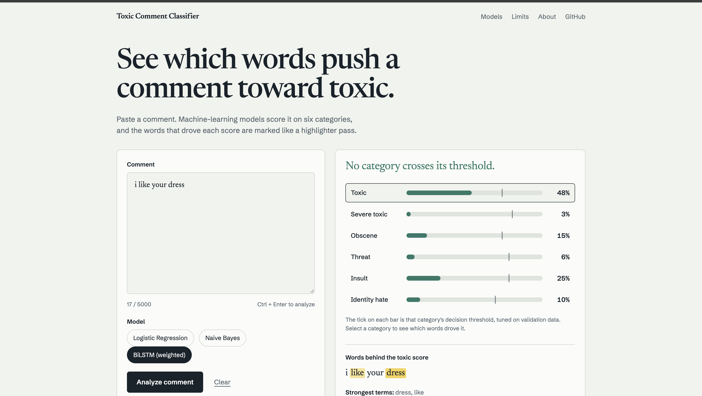
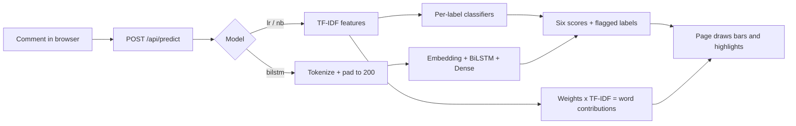

# Toxic Comment Classifier

**See which words push a comment toward toxic.**

A full-stack web app that scores a comment on six toxicity categories and highlights the words that drove each score. It serves three models side by side: Logistic Regression, Naive Bayes and a class-weighted BiLSTM, all trained on the Jigsaw Toxic Comment dataset.

**Live demo:** https://toxic-comment-site.onrender.com
*(The free hosting plan sleeps when idle, so the first visit after a break can take up to a minute.)*

   

---

## Features

- **Six categories at once:** toxic, severe toxic, obscene, threat, insult, identity hate. A comment can fall into several.
- **Three models to compare:** Logistic Regression, Naive Bayes and a weighted BiLSTM, switchable in the page.
- **Word-level explanation:** click any category to see the words behind its score, marked like a highlighter pass. Highlights come from the Logistic Regression weights.
- **Per-label thresholds:** the BiLSTM uses a separate decision threshold for each category, tuned on validation data, instead of a flat 50%.
- **Private by design:** comments are scored in memory and are not stored or logged.
- **Honest about limits:** the page explains where the models fail, with real false-alarm examples.

## How it works



- **Logistic Regression and Naive Bayes** read TF-IDF features (single words and word pairs) and train one binary classifier per label. Logistic Regression uses balanced class weights.
- **BiLSTM** reads the comment as a sequence of words, forwards and backwards, and scores all six labels at once. Rare labels get extra weight in the loss, and each label has its own tuned threshold.
- **Explanations** multiply each word's Logistic Regression weight by its TF-IDF value, so the biggest contributors are the words marked on the page.

## Results

Averages across the six labels on the Jigsaw dataset:

| Model | Mean ROC-AUC | Mean F1 | Notes |
|---|---|---|---|
| Logistic Regression | 0.976 | 0.570 | Balanced class weights, threshold 0.5 |
| Naive Bayes | 0.917 | 0.404 | Complement Naive Bayes, threshold 0.5 |
| BiLSTM (weighted) | 0.981 | 0.558 | Per-label tuned thresholds, 10% test split |

The BiLSTM figures were measured on its held-out test split (15,956 comments), with thresholds tuned on a separate validation split. The Logistic Regression and Naive Bayes figures come from an earlier 80/20 evaluation, so the rows are not exactly like for like.

Per-label results for the BiLSTM on the test split:

| Label | ROC-AUC | F1 | Test positives |
|---|---|---|---|
| toxic | 0.975 | 0.805 | 1,517 |
| severe toxic | 0.989 | 0.458 | 147 |
| obscene | 0.987 | 0.807 | 828 |
| threat | 0.972 | 0.158 | 38 |
| insult | 0.983 | 0.710 | 785 |
| identity hate | 0.977 | 0.408 | 145 |

Threat is the weakest label, and with only 38 test examples its score is unstable. These are single-run results with no confidence intervals.

## Tech stack

| Layer | Tools |
|---|---|
| Backend | Python, FastAPI, Uvicorn |
| Models | scikit-learn 1.6.1 (TF-IDF, Logistic Regression, Naive Bayes), BiLSTM trained in TensorFlow/Keras |
| BiLSTM serving | Pure NumPy inference, so the server needs no TensorFlow |
| Frontend | HTML, CSS and JavaScript, no build step |
| Hosting | Render (free plan) |

## Project structure

```
toxic-comment-site/
├── app/
│   ├── main.py              # FastAPI app: /api/predict, /api/health, serves the page
│   ├── bilstm.py            # NumPy BiLSTM inference + the exact training-time text cleaning
│   └── static/              # Frontend
│       ├── index.html
│       ├── style.css
│       └── app.js
├── models/
│   ├── vectorizer.joblib    # TF-IDF vectorizer
│   ├── lr_model.joblib      # Logistic Regression (one classifier per label)
│   ├── nb_model.joblib      # Complement Naive Bayes
│   ├── bilstm_weights.npz   # BiLSTM weights exported from Colab
│   └── bilstm_meta.json     # Vocabulary, sequence length, per-label thresholds
├── export_bilstm_for_website.py   # Colab cell that exports the BiLSTM files
├── requirements.txt
├── render.yaml              # Deployment settings for Render
└── README.md
```

## Run it locally

You need Python 3.9 to 3.13 (3.12 recommended).

```bash
git clone https://github.com/adityam1910/toxic-comment-site.git
cd toxic-comment-site

python3.12 -m venv .venv
source .venv/bin/activate          # Windows: .venv\Scripts\activate

pip install -r requirements.txt
python -m uvicorn app.main:app --reload
```

Open http://localhost:8000. Interactive API docs are at http://localhost:8000/api/docs.
 Live at https://toxic-comment-site.onrender.com/

## API

### `POST /api/predict`

```json
{ "text": "You are an idiot and nobody wants you here.", "model": "bilstm" }
```

`model` is `lr`, `nb` or `bilstm`. The text can be up to 5,000 characters.

Response (shortened):

```json
{
  "model": "bilstm",
  "thresholds": { "toxic": 0.7, "severe_toxic": 0.775, "...": "..." },
  "scores": { "toxic": 0.93, "severe_toxic": 0.12, "...": "..." },
  "flagged": ["toxic", "insult"],
  "words": [{ "start": 8, "end": 13, "w": [0.4, 0.1, 0.2, 0.0, 0.9, 0.1] }],
  "top_terms": { "toxic": [{ "term": "idiot", "w": 1.9 }] },
  "chars": 43
}
```

- `scores`: probability for each of the six labels.
- `thresholds`: the decision threshold used for each label (0.5 for `lr` and `nb`).
- `flagged`: labels whose score reached their threshold.
- `words`: per-word contributions (character offsets into your text) used for the highlights.

### `GET /api/health`

Returns the available models. `bilstm` appears only when its two files are present in `models/`.

## Deploy

1. Push the repository to GitHub.
2. On [render.com](https://render.com), create a **Web Service** from the repository.
3. Settings:
   - Build command: `pip install -r requirements.txt`
   - Start command: `uvicorn app.main:app --host 0.0.0.0 --port $PORT`
   - Instance type: Free
   - Environment variable: `PYTHON_VERSION` = `3.12.7`

`render.yaml` in this repository holds the same settings.

## Design notes

- **BiLSTM in NumPy:** TensorFlow is hundreds of megabytes and does not suit a free hosting plan. The exported weights run through a small NumPy implementation of the same network (Embedding, Bidirectional LSTM, Dense, Dense). It matches Keras predictions to within about 1e-7 on the reference comments.
- **Two different text cleaners:** the BiLSTM was trained with its own cleaning (punctuation removed, digits kept), while the TF-IDF models use letters only. The backend applies the matching cleaner for each model.
- **Pinned scikit-learn:** the `.joblib` files were saved with scikit-learn 1.6.1 and may fail to load on other versions. Re-save the models before upgrading.

## Limitations and responsible use

- A score is a signal for a person to review, not a judgement about a comment or its author. Do not use it to remove content or penalize anyone automatically.
- **False alarms happen.** For example, "i like your dress" is flagged as toxic by Logistic Regression and Naive Bayes. Very short comments are especially unreliable: a single known word can carry the whole score.
- The models were trained on **English Wikipedia talk-page comments**. They can misread sarcasm, quotes, slang, other languages and mentions of identity groups.
- Rare labels (threat, identity hate, severe toxic) have few examples, so their scores are less reliable.
- This project has **not** been through a fairness audit.
- Results are from a single run on one split, with no confidence intervals.

## Research background

This site accompanies a student research project on class imbalance in multilabel toxic-comment detection. In a matched BiLSTM comparison, weighting the loss toward rare labels raised test macro-F1 from 0.4057 to 0.5469 at a 0.5 threshold, with lower micro-F1. The live BiLSTM is a later re-run, so its numbers (above) differ slightly from the paper's.

*Investigating the Impact of Class Imbalance on Machine Learning and Deep Learning Models for Multilabel Toxic Comment Detection*

## Data

[Jigsaw Toxic Comment Classification Challenge](https://www.kaggle.com/c/jigsaw-toxic-comment-classification-challenge) on Kaggle. The training data is not included in this repository. Check the dataset's terms before redistributing it.

## Author

**Aditya Raj Mathur**, B.Tech in Computer and Communication Engineering, Manipal University Jaipur.
Supervised by **Dr. Anshika Malsaria**.

A student research project, not a moderation product.
